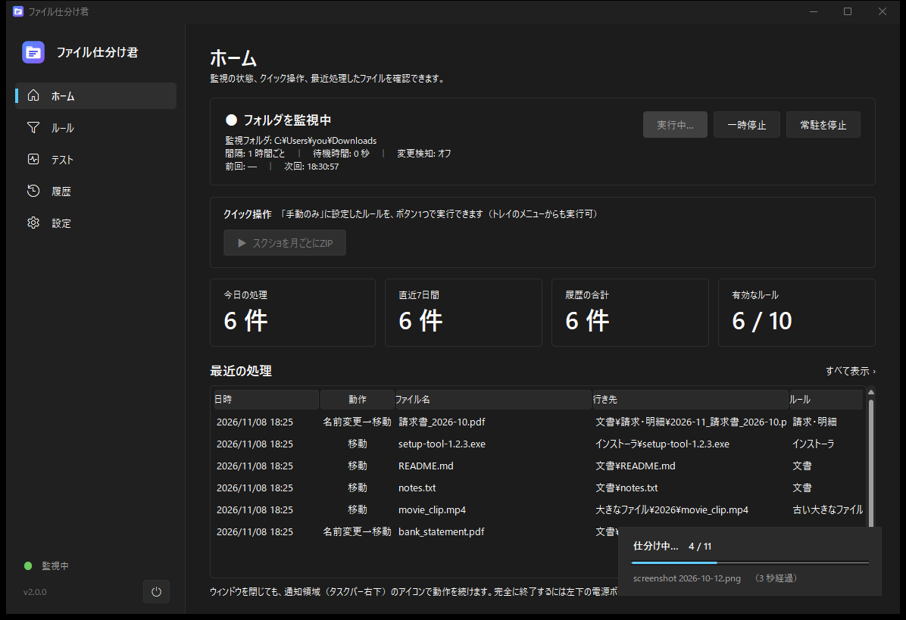
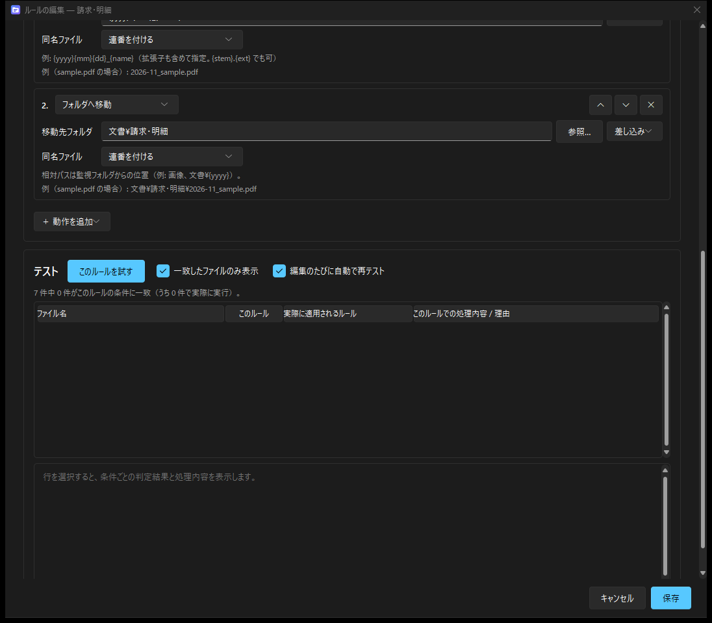
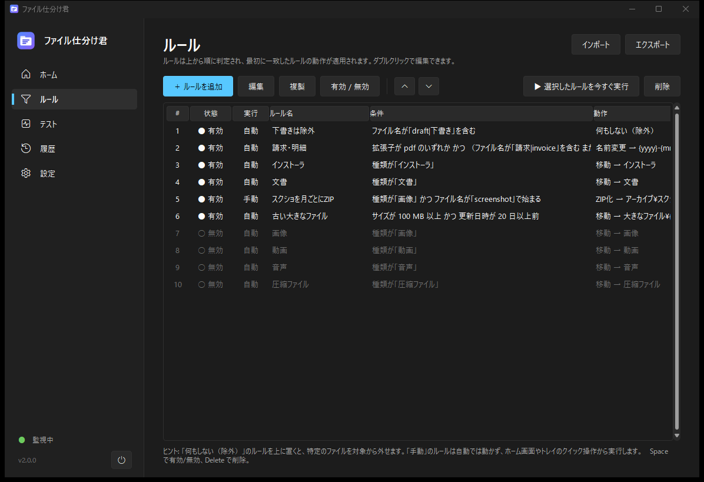
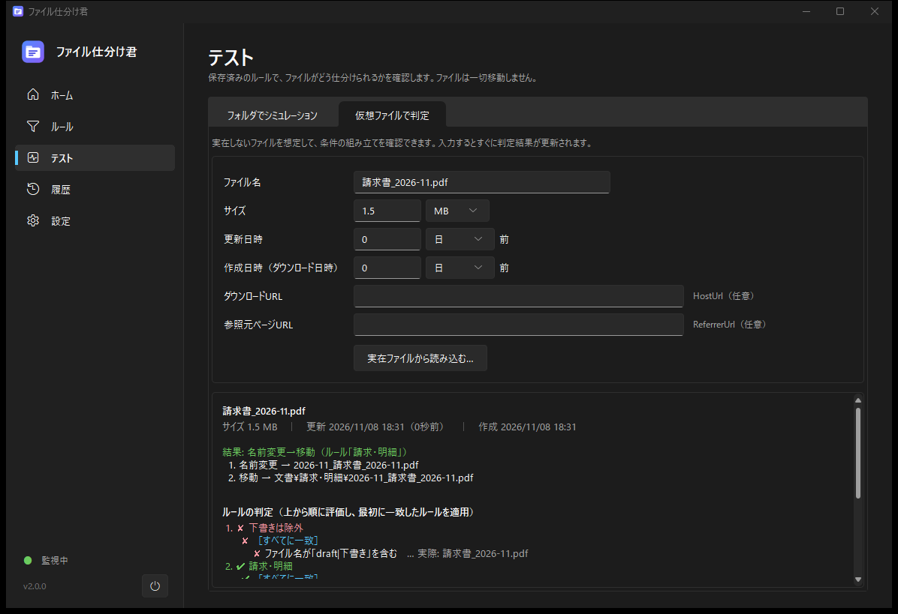

# ファイル仕分け君

ダウンロードフォルダを見張って、ルールに合うファイルを自動で **移動・名前変更・ZIP 化** などしてくれる、Windows 用の軽量な常駐ツールです。



- **軽い**：常駐プロセスは標準ライブラリだけで動作（メモリ約 15MB、待機中の CPU 使用率 0）。設定画面は開いている間だけ起動
- **柔軟な条件**：ファイル名・拡張子・種類・サイズ・日時・ダウンロード元 URL を、AND / OR / 否定のグループで入れ子に組み合わせ
- **多彩な動作**：移動・コピー・名前変更・ZIP にまとめる・ZIP を展開・ごみ箱・コマンド実行を順番に実行
- **ZIP のまとめ方を選べる**：条件に合ったファイルを、更新月ごと・日ごと・拡張子ごと・種類ごと・すべて1つ などの単位で ZIP に。実行前に「どの ZIP に何件入るか」を確認できる
- **試してから使える**：実際のファイルでシミュレーション、仮想ファイルで判定、ルール編集中に自動で再テスト
- **安全**：完全削除はしない（ごみ箱へ）。履歴から「元に戻す」が可能。ダウンロード中のファイルには触らない
- **クイック操作**：手動用のルールをホーム画面やトレイメニューから1クリックで実行
- **持ち運べる**：ポータブルモード＋ exe 版（Python 不要）

## スクリーンショット

| ルールの編集（入れ子の条件） | 複数の動作とその場でテスト |
|---|---|
|  |  |

| ルール一覧 | 仮想ファイルで判定 |
|---|---|
|  |  |

ライトテーマ・システム設定連動にも対応しています（[ライトテーマの例](docs/images/home-light.png)）。

## インストール

### A. exe 版（Python 不要）

1. [Releases](../../releases) から `FileSortKun-vX.Y.Z-win64.zip` をダウンロードして、好きな場所に展開
2. `FileSortKun.exe` を起動

展開したフォルダには `portable.txt` が入っているため、設定と履歴はフォルダ内の `data` に保存されます（ポータブルモード）。フォルダごと別の PC や USB メモリにコピーして使えます。

### B. ソースから実行

Windows 10 / 11、Python 3.10 以上（公式版、tkinter 同梱）が必要です。

このリポジトリを `git clone`（または「Code → Download ZIP」で取得）して、そのフォルダで次を実行します。

```
pip install -r requirements.txt
pythonw run.pyw
```

`powershell -ExecutionPolicy Bypass -File tools\create_shortcut.ps1` で起動用ショートカットを作成できます（`-StartMenu` でスタートメニューにも作成）。

## 使い方

1. **ルール**画面でルールを作る（サンプルは安全のため無効状態で入っています）
2. 編集画面下部の **テスト** や **テスト**画面で、どのファイルがどう処理されるかを確認
3. 有効にすると、指定した間隔（既定 5 分）で自動実行。すぐ実行したいときは「今すぐ仕分け」
4. 自動起動したい場合は **設定** →「Windows へのサインイン時に自動で起動する」

ウィンドウを閉じても通知領域（タスクバー右下）で動き続けます。止めるときはホーム画面の「常駐を停止」、完全に終了するにはサイドバー左下の電源ボタンを押します。

### ルールの例

| やりたいこと | 条件 | 動作 |
|---|---|---|
| 画像を種類別フォルダへ | 種類が「画像」 | 移動 → `画像` |
| 請求書を月別に整理 | 拡張子 pdf **かつ**（名前に「請求」を含む **または** 銀行サイトから） | 名前変更 `{yyyy}-{mm}_{name}` → 移動 `文書\請求` |
| 古いスクショを月ごとに ZIP | 種類が画像 **かつ** 名前が `screenshot` で始まる **かつ** 更新 30 日以上前 | ZIP 化（まとめ方：更新月ごと、保存先 `アーカイブ`）→ `アーカイブ\2026-09.zip` など（元はごみ箱へ） |
| ダウンロードした ZIP を展開 | 拡張子 zip | 展開 → `{stem}` |
| 下書きは触らない | 名前に「draft」を含む | 何もしない（除外） |
| 古いインストーラを掃除 | 種類がインストーラ **かつ** 更新 90 日以上前 | ごみ箱へ |

差し込み：`{name}` `{stem}` `{ext}` `{category}` `{yyyy}` `{mm}` `{dd}`（更新日）`{cyyyy}` `{cmm}` `{cdd}`（作成日）`{today}` `{host}`（ダウンロード元ドメイン）`{rule}`、コマンドでは `{path}` `{dir}` も使えます。

> 別のドライブからコピーしたファイルは、作成日がコピーした日になります。月ごとの整理には更新日（`{yyyy}` `{mm}`、ZIP の「更新月ごと」）がおすすめです。

## 開発

```
python -m unittest discover -s tests -v      # ユニットテスト
python run.pyw --simulate                   # 判定結果をコンソールに表示（ファイルは動かさない）
powershell -ExecutionPolicy Bypass -File tools\build_exe.ps1   # exe 版をビルド（dist\FileSortKun）
```

- 仕様書：[docs/仕様書.md](docs/仕様書.md)（設計・データ形式・判定の流れ）
- 変更履歴：[CHANGELOG.md](CHANGELOG.md)
- 構成：`filesorter/`（`rules.py` 判定 / `actions.py` 動作 / `engine.py` 実行 / `resident.py`・`tray.py` 常駐 / `gui/` 画面）

判定ロジックは GUI のテスト機能と常駐プロセスで共通なので、「テストで見た結果」と「実際の処理」は必ず一致します。

## ライセンス

[MIT](LICENSE)。GUI テーマに [sv-ttk](https://github.com/rdbende/Sun-Valley-ttk-theme)（MIT）を使用しています。
